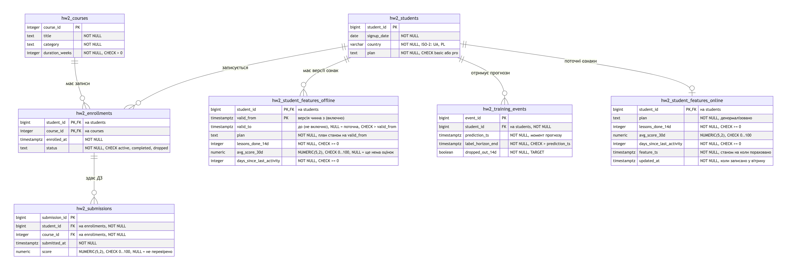

# goit-rdb-hw-02

Домашнє завдання 2 з курсу реляційних баз даних (GoIT Neoversity). Схема даних для ML-сценарію: бізнесові сутності, offline- і online-рівні feature store, навчальна вибірка без data leakage через AS-OF JOIN.

## Сценарій

Онлайн-школа хоче заздалегідь бачити студентів, які можуть кинути навчання. Модель у момент `prediction_ts` оцінює студента: чи не буде в нього жодної активності наступні 14 днів (`dropped_out_14d`). Зерно прогнозу: студент.

## Файли

| Файл | Що всередині |
|---|---|
| `RDB_HOMEWORK2.ipynb` | notebook з усіма завданнями: DDL, тестові дані, AS-OF запити, тексти |
| `diagram/er_diagram.png` | ER-діаграма |
| `diagram/er_diagram.svg` | та сама діаграма у векторі |
| `diagram/er_diagram.mmd` | діаграма як текст (Mermaid) |

## ER-діаграма

## Як запустити

1. Відкрити `RDB_HOMEWORK2.ipynb` у Google Colab.
2. Runtime → Run all.

Перша клітинка ставить `pixeltable-pgserver==0.4.0`, `jupysql` і `psycopg`. PostgreSQL 16.10 запускається прямо в runtime Colab, окремий сервер не потрібен. Оригінальний пакет `pgserver` на поточній версії Python у Colab не встановлюється, а цей форк має той самий API.

## Де що в notebook

| Завдання | Розділ |
|---|---|
| 1. ER-діаграма | картинка і Mermaid-код на початку notebook |
| 2. DDL | 7 таблиць `hw2_*` з PK, FK, NOT NULL, CHECK та індексами, перевірка обмежень через `try_sql` |
| 3. Нормалізація | текст після розділу про оновлення online-вітрини |
| 4. Point-in-time | 4 AS-OF SELECT, AS-OF JOIN за `prediction_ts`, діагностика наївного JOIN, перевірка перекриттів (0 рядків) |
| 5. Reflection | останній розділ |
